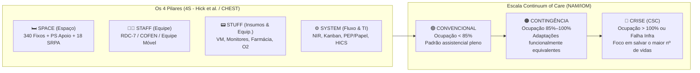

# 🧠 Brainstorm Estratégico Baseado em Evidências — Plano de Contingência HRO

> [!IMPORTANT]
> **Perfil Estrutural Calibrado do Hospital (Regra de Ouro HRO):**
> - **340 Leitos Fixos de Internação e Terapia Intensiva:**
>   - **70 Leitos de UTI (20,6% dos leitos fixos):** `UTI-AD` (40), `UTI-NEO` (20), `UTI-PED` (10).
>   - **270 Leitos de Enfermaria / Internação:** `CLIN-CIR` (85), `CLIN-MED` (80), `ONCO-UNA` (45), `MAT-OBST` (35), `PED-CLIN` (25).
> - **Leitos de Apoio (Porta de Entrada):** Ocupação do Pronto-Socorro (`PS-EMERG`) contabilizada como suporte de urgência/observação (*boarding*).
> - **Apoio Perioperatório:** **18 leitos fixos na SRPA** (`CC-SRPA`) + 10 Salas Cirúrgicas.
> - **Perfil Assistencial:** Hospital terciário de alta complexidade macrorregional (Trauma/Neurocirurgia BR-282, UNACON Oncologia, Gestação de Alto Risco, Linha de Cuidado AVC/IAM).

---

## 1. Arquitetura Científica de Resposta: O Modelo *4S* e a Escala *Continuum of Care*

A literatura internacional de medicina de desastres e gestão de capacidade hospitalar — capitaneada pelo **Institute of Medicine / National Academy of Medicine (IOM/NAM)**, pelo consenso **CHEST Mass Critical Care (Hick et al.)** e, no Brasil, pela metodologia **Lean nas Emergências (PROADI-SUS / Sírio-Libanês)** e diretrizes do **Núcleo Interno de Regulação (NIR / PNHOSP)** — demonstra que planos de contingência falham quando tratam crises de forma isolada.

Toda decisão crítica no HRO deve ser tomada cruzando os **4 Pilares (*4S*)** em **3 Níveis de Cuidado**:

---

## 2. Brainstorm de Decisões de Alto Impacto por Cenário Crítico do HRO

### Cenário A — Superlotação do Centro Cirúrgico + Cirurgias Leito-Dependentes + UTI Travada sem Leito de Alta (*Gridlock Cirúrgico-Intensivo*)

**O que diz a evidência científica:**
Estudos de *Operations Research* em saúde (Litvak et al., *Institute for Healthcare Optimization*; *American College of Surgeons*) provam que o bloqueio do Centro Cirúrgico e da SRPA raramente decorre de ineficiência cirúrgica: ele é causado pelo **Exit Block da UTI** (pacientes de *step-down* que não conseguem sair dos 40 leitos da `UTI-AD` porque os 85 leitos da `CLIN-CIR` e os 80 da `CLIN-MED` estão 100% ocupados) somado à **variabilidade artificial do agendamento de cirurgias eletivas leito-dependentes** (*peaked scheduling* às terças e quartas-feiras).

#### 🎯 Melhores Decisões para o Perfil do HRO:
1. **Regra do "Giro Reverso Puxado" (*Pull System* / *Reverse Triage* — Kelen et al., Johns Hopkins):**
   - Antes de suspender cirurgias oncológicas (`ONCO-UNA`) ou neurocirúrgicas, o **NIR** não tenta "empurrar" o paciente da SRPA para a UTI; ele **puxa** a fila a partir da ponta final:
     - **Passo 1 (Enfermarias 85 `CLIN-CIR` + 80 `CLIN-MED`):** Acionar *Fast-Track Discharge* até as 10h00 da manhã usando **Lounge de Alta (*Discharge Lounge*)**. Pacientes com alta assinada que aguardam apenas transporte da família/ambulância municipal ou receita saem do leito físico às 09h00 e aguardam na Sala de Acolhimento de Alta, liberando imediatamente **8 a 12 leitos físicos** nas enfermarias.
     - **Passo 2 (Desbloqueio da `UTI-AD` - 40 leitos):** Transferência imediata (em até 45 min após liberação do leito de enfermaria) dos pacientes de pré-alta da `UTI-AD` (`NEWS2 ≤ 3`, sem DVA/VM há >24h).
     - **Passo 3 (Escoamento dos 18 leitos da `CC-SRPA`):** Admissão imediata dos pós-operatórios leito-dependentes retidos na SRPA/Salas Cirúrgicas para a `UTI-AD`.
2. **Protocolo de *Surgical Smoothing* com Teto de Reserva de UTI (*Quota System*):**
   - Limitar o agendamento de cirurgias eletivas **leito-dependentes** (que exigem vaga garantida nos 40 leitos da `UTI-AD`) a um teto máximo diário fixo (ex.: máximo de **3 cirurgias eletivas leito-dependentes/dia**, distribuídas uniformemente de segunda a sexta), proibindo concentração de cirurgias de grande porte no mesmo dia.
3. **Gatilho de Semáforo da SRPA (18 Leitos):**
   - **SRPA com 12/18 ocupados (Verde):** Mapa cirúrgico liberado.
   - **SRPA com 15/18 ocupados ou ≥ 2 pós-op intubados retidos há >2h (Amarelo):** Suspensão automática do bloco seguinte de eletivas leito-dependentes; permissão apenas para cirurgias ambulatoriais/enfermaria e urgências.
   - **SRPA com 18/18 ocupados ou Sala Cirúrgica travada como UTI (Vermelho):** Ativação temporária de **Unidade Semi-Intensiva de Transição (4 a 6 leitos monitorizados na `CLIN-CIR`)** para receber imediatamente as altas da `UTI-AD` e destravar o bloco cirúrgico.

---

### Cenário B — Superlotação do Pronto-Socorro (`PS-EMERG` — Leitos de Apoio) vs. 340 Leitos Fixos

**O que diz a evidência científica:**
O **Full Capacity Protocol (FCP — Dr. Peter Viccellio, Stony Brook University)**, validado pela *ACEP* e pelo programa *Lean nas Emergências*, demonstrou em dezenas de hospitais terciários que manter 50+ pacientes internados em macas no Pronto-Socorro (*ED Boarding*) aumenta a mortalidade hospitalar geral e os erros de medicação muito mais do que distribuir temporariamente o excedente.

#### 🎯 Melhores Decisões para o Perfil do HRO:
1. **Protocolo de Capacidade Plena Distribuída (*Full Capacity Protocol* — Regra "Mais 2 por Ala"):**
   - Quando a ocupação de apoio do `PS-EMERG` ultrapassar o gatilho crítico (NEDOCS $\ge 140$ ou $>15$ pacientes com ordem de internação retidos há $>6\text{h}$), em vez de acumular 20 macas extras apenas no PS, o NIR distribui **no máximo 2 leitos extras de contingência** para cada unidade fixa compatível (`CLIN-CIR` 85, `CLIN-MED` 80, `ONCO-UNA` 45, `PED-CLIN` 25).
   - **Por que funciona na literatura:** Dilui o risco assistencial (1 enfermaria de 85 leitos absorver +2 pacientes representa +2,3% de carga; manter +20 pacientes no PS representa +45% de colapso na emergência) e acelera a alta em 24h porque as equipes médicas das enfermarias passam visita mais cedo nos pacientes alocados em suas próprias alas.
2. **Kanban Digital/Visual com *Huddle* Multidisciplinar 2x/dia (08h30 e 15h30):**
   - Classificar todos os 340 leitos fixos por cores de permanência e **pendência única para alta** (ex.: *Aguardando Tomografia*, *Aguardando Parecer Cirurgia Vascular*, *Aguardando Antibiótico Oral*). Pacientes em cartão vermelho no Kanban têm prioridade zero na fila da radiologia e laboratório.

---

### Cenário C — Falta de Monitores Multiparamétricos, Ventiladores Mecânicos e Quantitativo Insuficiente

**O que diz a evidência científica:**
As diretrizes do **CHEST Consensus Statement on Mass Critical Care** e da **ASA (American Society of Anesthesiologists)** estabelecem uma hierarquia estrita de realocação tecnológica antes de qualquer racionamento ético.

#### 🎯 Melhores Decisões para o Perfil do HRO:
1. **Matriz de Escalonamento de Ventiladores Mecânicos (3 Níveis):**
   - **Nível 1 (Remanejamento Interno):** Recolher imediatamente ventiladores de transporte subutilizados e ventiladores de reserva das enfermarias (`CLIN-CIR`, `CLIN-MED`) para `UTI-AD`, `CC-SRPA` e `PS-EMERG`.
   - **Nível 2 (Conversão de Aparelhos de Anestesia e VNI):** Utilizar os aparelhos de anestesia das salas cirúrgicas (com supervisão de anestesiologista/fisioterapeuta conforme diretriz ASA/AMIB) para ventilar pacientes pós-operatórios nos **18 leitos da SRPA** e converter pacientes com insuficiência respiratória moderada para **VNI / CPAP / CNAFO** para poupar ventiladores invasivos microprocessados.
   - **Nível 3 (Desmame Ventilatório Acelerado — Protocolo *SAT + SBT* Diário):** Fisioterapia intensiva executa despertar diário (*Spontaneous Awakening Trial*) + teste de respiração espontânea (*Spontaneous Breathing Trial*) às 07h00 em 100% dos intubados da `UTI-AD` (40 leitos), reduzindo o tempo médio de VM em 1,5 a 2 dias (Girard et al., *The Lancet*).
2. **Estratificação de Monitores Multiparamétricos (*Step-Down Monitoring*):**
   - **Proibição de monitor multiparamétrico contínuo em pacientes `NEWS2 ≤ 3`:** Na falta de monitores, pacientes estáveis em enfermaria ou pré-alta na UTI/SRPA passam para **monitorização intermitente por oximetria portátil + esfigmomanômetro a cada 2h–4h**, liberando os monitores multiparamétricos de cabeceira para pacientes em uso de droga vasoativa (`DVA`), pós-op leito-dependente na `CC-SRPA` (18 leitos) e Sala Vermelha do `PS-EMERG`.

---

### Cenário D — Ruptura / Falta de Medicamentos Essenciais

**O que diz a evidência científica:**
As diretrizes da **ASHP (American Society of Health-System Pharmacists)** e do **ISMP (Instituto para Práticas Seguras no Uso de Medicamentos)** demonstram que rupturas gerenciadas sem protocolo padronizado aumentam em **3,5 vezes os erros de dose** porque os médicos prescrevem substitutos com os quais a enfermagem não tem familiaridade de diluição.

#### 🎯 Melhores Decisões para o Perfil do HRO:
1. **Substituição Terapêutica Automática Pré-Aprovada pela CFT no PEP:**
   - Nunca deixar a escolha do substituto para o improviso individual do plantão: travar no sistema a conversão automática já com **diluição e vazão padronizadas** (ex.: falta de *Fentanila* $\rightarrow$ protocolo fechado de *Morfina* ou *Cetamina* poupadora de opioide; falta de *Piperacilina+Tazobactam* $\rightarrow$ *Meropenem* em infusão estendida de 3h, que reduz o consumo diário de frascos em 25–33% mantendo eficácia farmacocinética $\%T > \text{MIC}$).
2. **Transição Precoce EV $\rightarrow$ VO (*IV-to-PO Switch*):**
   - Converter antimicrobianos, analgésicos, antieméticos e inibidores de bomba de prótons endovenosos para via oral/enteral em todos os pacientes das enfermarias (`CLIN-CIR`, `CLIN-MED`, `ONCO-UNA`) com trato gastrointestinal funcionante e afebris há 24h, preservando ampolas injetáveis exclusivamente para os 70 leitos de UTI, 18 da SRPA e Sala Vermelha.

---

### Cenário E — Queda do Sistema Informatizado sem Previsão de Retorno (*EHR Downtime Indeterminado*)

**O que diz a evidência científica:**
Os **ONC SAFER Guides (*Safety Assurance Factors for EHR Resilience* — Sittig & Singh)** apontam que os dois maiores riscos fatais durante um *downtime* prolongado (>12h–72h) são: (1) **administração de medicamento ao qual o paciente é alérgico** (pela perda do alerta eletrônico) e (2) **extravio de resultados críticos de laboratório/imagem** (*panic values*).

#### 🎯 Melhores Decisões para o Perfil do HRO:
1. **Estações Locais de Contingência (*Downtime Computers* + Impressora Laser em Nobreak):**
   - Manter 1 computador isolado da rede em cada posto de enfermagem (UTI, PS, SRPA, Enfermarias) que recebe a cada 15 minutos um **Snapshot PDF/HTML somente-leitura** das prescrições vigentes dos 340 leitos fixos + PS + 18 SRPA. Se a rede cair, a enfermagem imprime imediatamente a última prescrição válida sem precisar redigitar ou transcrever à mão do zero.
2. **Protocolo de "Três Vias Carbonadas + Pulseira Vermelha de Alergia":**
   - Formulário físico padronizado em 3 vias (1ª via: Prontuário/Checagem Beira-Leito; 2ª via: Farmácia Satélite; 3ª via: Conciliação posterior).
   - **Dupla checagem presencial obrigatória (Médico + Enfermeiro)** antes de instalar qualquer bomba de infusão de Droga Vasoativa ou Quimioterápico (`ONCO-UNA`).
3. **Escala de *Runners* (Mensageiros Físicos Dedicados a cada 30 min):**
   - Deslocar técnicos administrativos para rota física cronometrada a cada 30 minutos entre `UTI-AD` / `PS-EMERG` / `CC-SRPA` $\leftrightarrow$ Laboratório Central e Farmácia, com carimbo vermelho para exames de Troponina, Gasometria, Lactato e Hemoterapia.

---

### Cenário F — Queda de Energia por Tempo Indeterminado + Falha Parcial/Total de Geradores

**O que diz a evidência científica:**
O índice **WHO Hospital Safety Index (OMS/OPAS)** e a norma **NFPA 99 (Health Care Facilities Code)** demonstram que a janela crítica de sobrevivência em falha de geradores é ditada pelos **primeiros 15 a 45 minutos** (autonomia real das baterias internas de ventiladores e bombas de infusão, que frequentemente degradam mais rápido que o nominal).

#### 🎯 Melhores Decisões para o Perfil do HRO:
1. **Regra "1 Ventilado = 1 Ressuscitador Manual (Ambu) + 1 Cilindro Torpedo no Leito":**
   - Nos 70 leitos de UTI (`UTI-AD` 40, `UTI-NEO` 20, `UTI-PED` 10), nos 18 leitos da `CC-SRPA` e na Sala Vermelha do `PS-EMERG`, manter permanentemente 1 Ambu com válvula PEEP acoplado a fluxômetro de parede (que funciona por pressão pneumática da usina/tanque criogênico de O2 mesmo sem energia elétrica).
2. **Descarte de Cargas e Coorte Vertical de Energia (*Load Shedding & Horizontal Evacuation*):**
   - Em falha parcial de geradores, desligar imediatamente 100% da climatização de áreas administrativas/enfermarias, iluminação secundária e elevadores não essenciais, concentrando toda a carga elétrica remanente e os **no-breaks (UPS)** exclusivamente em: `UTI-AD` (40), `UTI-NEO` (20), `UTI-PED` (10), `CC-SRPA` (18) e Banco de Sangue/Farmácia (cadeia de frio).
3. **Simplificação de Infusões Contínuas:**
   - Suspender bombas de infusão de soroterapia de manutenção e dieta enteral (que consomem tomadas e baterias), mantendo em bateria **exclusivamente Bombas de Infusão de Drogas Vasoativas (Noradrenalina/Vasopressina) e Sedoanalgesia de pacientes intubados**.

---

## 3. Quadro-Resumo Executivo: Matriz de Gatilhos e Decisões Imediatas para o HRO

| Cenário / Gargalo no HRO | Gatilho Objetivo no Gêmeo Digital | Decisão Nível 1 (Imediata: 0–30 min) | Decisão Nível 2 (Tática: 30 min–2h) | Base Científica / Referência |
| :--- | :--- | :--- | :--- | :--- |
| **Gridlock Cirúrgico (`CC-SRPA` 18 leitos + `UTI-AD` 40 leitos)** | SRPA $\ge 15/18$ ou $\ge 2$ pós-op leito-dependentes retidos + `CLIN-CIR`/`CLIN-MED` com $0$ vagas | Ativar **Lounge de Alta** nas enfermarias (`CLIN-CIR` 85 / `CLIN-MED` 80) para liberar 8 leitos físicos até 10h00 | Puxar *step-down* da `UTI-AD` p/ enfermaria em $<45\text{ min}$ e suspender eletivas leito-dependentes do turno seguinte | *Reverse Triage* (Kelen et al.); *Surgical Smoothing* (Litvak / IHO) |
| **Superlotação do PS (`PS-EMERG` Apoio)** | $>15$ pacientes em *boarding* há $>6\text{h}$ ou ocupação apoio $>120\%$ | Acionar **Full Capacity Protocol (+2 leitos/ala)** nas 5 enfermarias fixas | *Huddle* Kanban com prioridade zero de laudos (TC/Lab) para pacientes em pré-alta nos 340 leitos fixos | *Full Capacity Protocol* (Viccellio / ACEP); *Lean nas Emergências* |
| **Falta de Ventiladores / Monitores** | Déficit $>0$ VM ou $>0$ Monitores Multiparamétricos | Retirar monitores contínuos de pacientes `NEWS2 ≤ 3` e alocar ventiladores de transporte / aparelhos de anestesia na SRPA | Protocolo *SAT+SBT* de extubação segura na `UTI-AD` e conversão de casos moderados para VNI/CPAP | *CHEST Mass Critical Care* (Hick et al.); *ASA Guidelines* |
| **Falta de Medicamentos** | Autonomia $<12\text{h}$ ou Ruptura (`0h`) de item vital | Ativar substituição terapêutica padronizada pela CFT em massa no PEP | Conversão em massa EV $\rightarrow$ VO nas enfermarias e infusão estendida de beta-lactâmicos | *ASHP Drug Shortages Guidelines*; *ISMP Brasil* |
| **Queda do Sistema (TI Offline s/ ETA)** | Indisponibilidade $>15\text{ min}$ sem previsão de retorno | Imprimir *Snapshot Local* de prescrições vigentes e ativar formulário físico carbonado (3 vias) | Dupla checagem presencial obrigatória p/ MAV/DVA + *Runners* físicos a cada 30 min (Lab/Farmácia) | *ONC SAFER Guides* (Sittig & Singh) |
| **Blackout + Falha de Geradores** | Queda de rede + falha parcial/total de geradores | Desligar bombas de soro/dieta (manter apenas DVA/Sedação em bateria) e acoplar Ambu + O2 pneumático nos leitos de VM | Evacuação horizontal intrahospitalar para o bloco coberto ou acionamento SAER-Fron / SAMU se $>45\text{ min}$ | *WHO Safe Hospitals*; *NFPA 99* |
